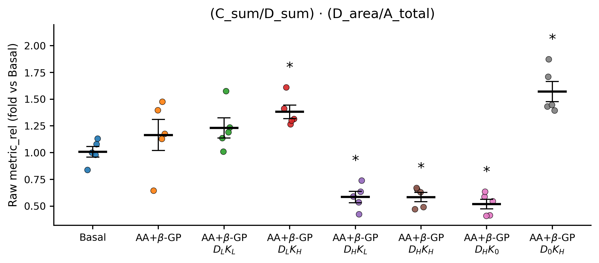
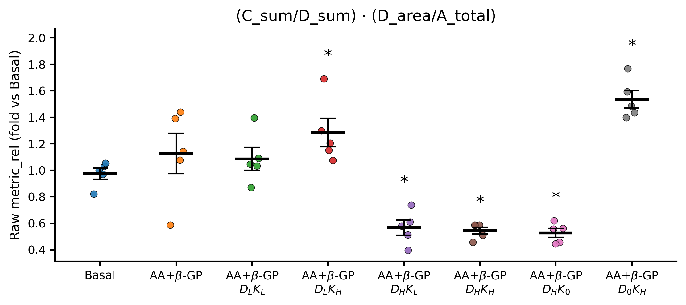
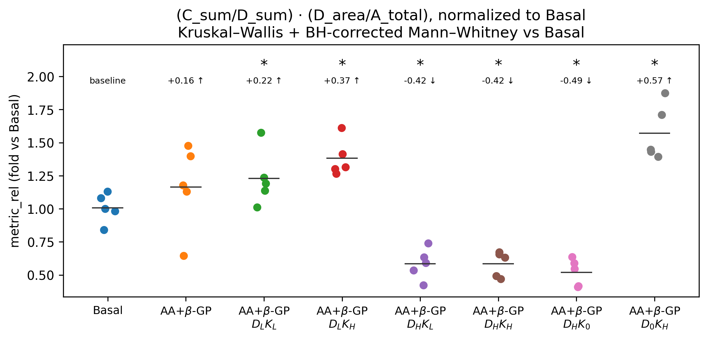
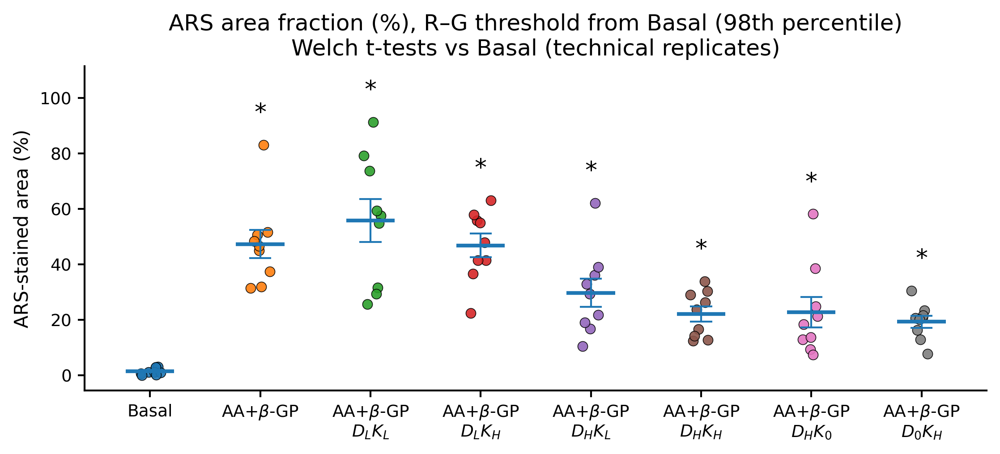

# Collagen Analysis

---

## 1. Overview

Each TIFF image is treated as a **technical replicate**.

From raw pixel intensities (no thresholding, no background subtraction), we compute:

- Total collagen signal
- Total DAPI signal
- Effective nuclear area proxy
- A composite collagen-per-cell–like metric

### Defined metric
V
\[
\text{metric} =
\left(\frac{C_{\text{sum}}}{D_{\text{sum}}}\right)
\cdot
\left(\frac{D_{\text{area}}}{A_{\text{total}}}\right)
\]

Where:

- \(C_{\text{sum}}\): sum of collagen channel intensities  
- \(D_{\text{sum}}\): sum of DAPI channel intensities  
- \(D_{\text{area}}\): number of pixels with DAPI ≠ 0  
- \(A_{\text{total}}\): total pixels in the image  

This partially corrects for:
- different cell numbers
- different nuclear sizes
- different field-of-view occupancies

---

## 2. Processing Steps (per image)

1. Read multichannel TIFF  
2. Extract:
   - DAPI channel
   - Collagen channel
3. Compute raw quantities:
   - `C_sum`
   - `D_sum`
   - `D_area`
   - `A_total`
4. Combine into a single scalar metric
5. Store results in a table (CSV)

---

## 3. Normalization Strategy

- Choose a **basal condition** (default: `C1`)
- Compute the **median metric** of basal images
- Normalize all images:

\[
\text{metric\_rel} = \frac{\text{metric}}{\text{median(metric)}_{\text{basal}}}
\]

This gives **fold-change vs basal** at the image level.

---

## 4. Statistics

- Each image = one technical replicate
- For each condition:
  - Mean ± SEM of `metric_rel`
- Statistical test:
  - **Welch’s t-test**
  - Each condition vs basal
  - Unequal variance assumed

⚠️ Interpretation is **technical**, not biological replication.

---

## Results: Collagen Raw Metric

<figure>
  
  <figcaption>
    Collagen raw metric normalized to basal (image-level).
  </figcaption>
</figure>

**Figure.** Image-level collagen metric  
\((C_\mathrm{sum}/D_\mathrm{sum}) \cdot (D_\mathrm{area}/A_\mathrm{total})\),  
normalized to basal (C1).  
Dots = individual images (technical replicates),  
line = mean, whiskers = SEM.

---

### Gaussian background + subtraction

For each channel, a slowly varying background was estimated using a Gaussian
filter (σ = 20 px) and subtracted prior to intensity integration:

\[
I_{\mathrm{corr}} = \max\!\left(I_{\mathrm{raw}} - G_{\sigma}(I_{\mathrm{raw}}),\ 0\right)
\]

All downstream metrics were computed from background-corrected images.

---

## Results: Collagen Metric Sigma

<figure>
  
  <figcaption>
    Gaussian-smoothed signals (σ = 20 px), no background subtraction.
  </figcaption>
</figure>

---

## Results: Collagen Metric Sigma w/ Subtraction

<figure>
  
  <figcaption>
    Background-corrected signals using Gaussian background estimation (σ = 20 px).
  </figcaption>
</figure>

---

## Non-parametric statistical analysis

Statistical analysis was performed on the normalized metric
\(\text{metric}_{\mathrm{rel}}\) using non-parametric methods.

### Kruskal–Wallis test

Overall differences across experimental conditions were first assessed using
the **Kruskal–Wallis H test**, a rank-based non-parametric analogue of one-way
ANOVA. The test evaluates the null hypothesis that all groups are drawn from
the same distribution, without assuming normality or equal variances.

Formally, the Kruskal–Wallis statistic is defined as:

\[
H =
\frac{12}{N(N+1)}
\sum_{i=1}^{k}
n_i
\left(\bar{R}_i - \frac{N+1}{2}\right)^2
\]

where:
- \(k\) is the number of groups,
- \(n_i\) is the sample size of group \(i\),
- \(\bar{R}_i\) is the mean rank of group \(i\),
- \(N\) is the total number of observations across all groups.

### Post-hoc comparisons

When the Kruskal–Wallis test indicated a global difference, **pairwise
two-sided Mann–Whitney U tests** were performed comparing each condition to
the basal reference group.

To control the false discovery rate arising from multiple comparisons,
p-values from pairwise tests were adjusted using the
**Benjamini–Hochberg procedure**.

### Effect size

In addition to p-values, **Cliff’s delta** was computed for each pairwise
comparison as a non-parametric effect size, quantifying the probability that
a randomly selected value from one group exceeds a randomly selected value
from another group.

An approximate **z-score** was also reported for each Mann–Whitney comparison
to indicate standardized effect direction and magnitude.

---

## Results: Non-Parametric Kruskal Wallis (Median Normalized)

<figure>
  
  <figcaption>
    Non parameteric.
  </figcaption>
</figure>

---

# ARS quantification (R–G thresholding)

## Overview
Alizarin Red S (ARS) staining was quantified from RGB images to assess **early mineralization**.  
Each image was treated as a **technical replicate**.

---

## Signal definition
For each pixel:
\[
D = R - G
\]
where \(R\) and \(G\) denote the red and green channel intensities, respectively.

---

## Control-calibrated threshold
A global threshold \(T_p\) was derived from **basal (C1)** images as the \(p\)-th percentile of the basal \(D\) distribution:
\[
T_p = \operatorname{percentile}_p(D_{\text{basal}})
\quad (p = 95\text{–}99,\ \text{default }98)
\]

Pixels in all conditions satisfying
\[
D > T_p
\]
were classified as **ARS-positive**.

---

## Quantification
For each image, the ARS-positive area fraction was computed as:
\[
f_{\text{ARS}} = \frac{N_{\text{ARS}}}{N_{\text{total}}} \times 100\%
\]
where \(N_{\text{ARS}}\) is the number of ARS-positive pixels and  
\(N_{\text{total}}\) is the total number of image pixels.

When pixel calibration was available, ARS-positive area was additionally reported in \(\mu\text{m}^2\).

---

## Visualization (QC)
ARS-positive pixels were optionally visualized as **cyan overlays** on the original images.  
Overlays were downscaled and exported as JPEG files for rapid quality control.

---

## Statistical analysis
Image-level ARS area fractions were compared to basal (C1) using **Welch’s t-test**:
\[
H_0:\ \mu_{\text{cond}} = \mu_{\text{basal}}
\]
Results are displayed as scatter plots with **mean ± SEM** and significance annotations.

---

## Rationale
This analysis:
- defines ARS positivity relative to basal background,
- prioritizes spatial extent over intensity,
- is suited for sparse, heterogeneous early mineralization,
- avoids arbitrary absolute thresholds.

---

## Results: ARS Stained Area

<figure>
  
  <figcaption>
    ARS stained area conditions.
  </figcaption>
</figure>