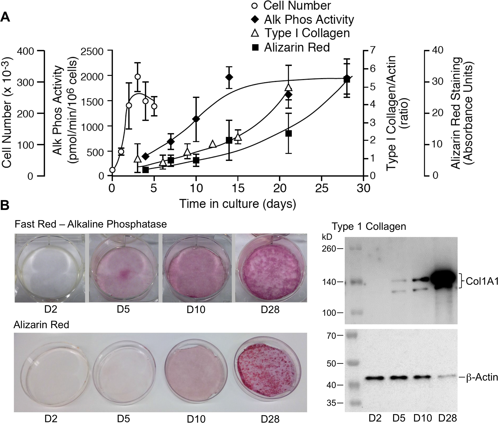

# For meeting w/ Aurélie @ 25.11.25

---


## **MC3T3-E1 Differentiation Summary**

**(Luttrell et al., 2019 — transcriptomic profiling of MC3T3-E1 differentiation)**

* **Differentiation begins after growth arrest**: once proliferation slows (day 3–4), the osteogenic program is activated.

* **AA is the trigger for matrix formation**: ascorbic acid drives collagen synthesis and is required for early osteoblastic commitment.

* **Collagen I increases during early differentiation**: between days 5–10, cells build a collagen-rich ECM that supports maturation.

* **ALP rises early**: alkaline phosphatase expression/activity increases soon after collagen matrix formation and marks early osteoblast differentiation.

* **β-GP supports mineralization, not differentiation**: β-glycerophosphate provides phosphate for ALP-mediated Pi release but does not activate ALP or initiate differentiation.

* **Mineralization is a late event**: calcium phosphate deposition becomes detectable after day 10 and strengthens as the matrix matures.


---

<p align="center">
  
</p>


---

## 1. AA: integration vs delay

**Why I use integration:**

* AA has a **very short half-life (~3 h)**, so its concentration drops rapidly after each medium change.
* Because of this, cells do *not* experience a constant 50 µg/mL; they see a **decay curve** over 24 h.
* Integrating this decay over 24 h gives an **effective average exposure**, which is what drives collagen production.

**Why not introduce a “delay”:**

* With only endpoint collagen-I/DAPI measurements, a separate delay parameter cannot be identified.
* The 24 h integral already captures sustained exposure without overfitting.

---

## 2. Saturation function *f(C)*

I currently use a Michaelis–Menten-type saturation:

```math
f(C) = \frac{C}{K_{\mathrm{AA}} + C}
```

**Why this form:**

* It rises quickly at low AA and plateaus at high AA → matches known AA–collagen behaviour.
* Basal vs Osteogenic give **two AA regimes (0 vs 50 µg/mL)** → simple form avoids overfitting.
* Only the amplitude parameters (baseline $(R_0)$ and AA-dependent increase $(R_{\mathrm{AA}})$) are fitted.

**Optional:** If needed, I can also test a Hill/logistic version.

---

## 3. Fitting + goodness of fit

### Data used

I will explicitly list the three endpoint measurements:

* **Collagen-I/DAPI** (collagen per cell)
* **ALP activity** (mU/mL)
* **ARS-positive area**

### Fitting plan

* Fit **only Basal + Osteogenic** to determine the baseline parameters, since these differ only by AA and β-GP.
* Fit a **minimal, constrained set**:

- Collagen module → $(R_0,\; R_{\mathrm{AA}})$
- ALP → Pi → $(k_{\mathrm{Pi}})$
- Mineral module → $(K_{\mathrm{NUC}},\; K_{\mathrm{HA}},\; S_{\mathrm{thresh}},\; C_{\mathrm{ACP,thresh}})$


### Goodness of fit

* Use simple **least-squares (RMSE)** across endpoints.
* Compare model vs measured values (mean ± SD) for interpretability.

---

## 4. H-function

* Yes — it is the **Heaviside step function**.
* It is used purely for threshold behaviour (ACP presence, collagen mask).
* If needed for numerical stability, I can switch to a **smooth logistic** version with the same threshold.

---

## 5. Calcium equation (C_Ca)

All Ca-related processes (diffusion, ACP formation, HA growth) will be merged into a **single mass-balanced PDE**:

```math
\frac{dC_{\mathrm{Ca}}}{dt}
= D_{\mathrm{Ca}} \nabla^2 C_{\mathrm{Ca}}
- 3\, r_{\mathrm{ACP}}
- r_{\mathrm{HA}}.
```

**Where:**

- $(3\, r_{\mathrm{ACP}})$ = Ca consumed during ACP formation
- $(r_{\mathrm{HA}})$ = Ca consumed during HA conversion


**Because:**

* All Ca processes occur simultaneously; merging avoids inconsistencies.
* One equation is easier to tune and interpret.
* Mass conservation becomes explicit.

Fitting will target the **final ARS-positive area** using this unified Ca balance.

---

## 6. Overall model structure

* **AA + β-GP** define the **baseline**, fitted on Basal/Osteo only.
* **MK-4** and **Dex** are included later only as **empirical scaling factors**
  (MK-4 → collagen boost; Dex → reduced mineral deposition efficiency).
* They are *not* added as new mechanistic pathways because endpoint-only data cannot constrain such models.

